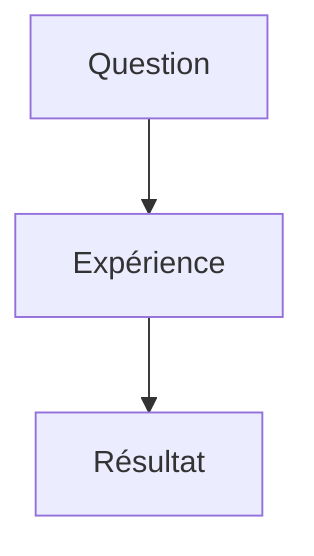

# Diagrammes Mermaid et tableaux blancs

## Installation après application des six patchs

Depuis la racine, avec Node 22.12+ ou Node 24 et PostgreSQL configuré :

```text
npm ci
npm run migrate
npm run typecheck
npm test -w client
npm test -w server
npm run build -w client
npm run dev
```

La migration `006_whiteboards.sql` est nécessaire avant de démarrer le serveur.
Les migrations 001 à 005 restent inchangées. La CI existante exécute déjà les
commandes de test des deux workspaces et appliquera la nouvelle migration dans
la base de test. Les tests serveur effacent TEST_DATABASE_URL : cette base doit
être isolée et différente de DATABASE_URL.

Versions ajoutées et verrouillées : Excalidraw 0.18.1, Mermaid 11.12.0,
DOMPurify 3.4.17, Milkdown Kit 7.22.3. Les peerDependencies du paquet Excalidraw
acceptent React/ReactDOM 18.3.1, versions utilisées par ce dépôt. Ni React ni
Milkdown ne sont mis à niveau par cette série. Les polices Excalidraw et leurs
licences sont copiées depuis le paquet npm vers `client/public/excalidraw/fonts`
par les scripts `predev` et `prebuild`. Ce répertoire généré est ignoré par Git.
Aucune police n'est chargée depuis un CDN dans l'intégration fournie.

## Mermaid dans les chapitres

Choisir **+ → Advanced → Mermaid**, ou créer un bloc Markdown classique :

````markdown

````

Milkdown conserve le bloc de code et son langage dans le Markdown. L'aperçu est
produit après 300 ms sans frappe. La bibliothèque Mermaid n'est importée qu'au
premier bloc à rendre. Une erreur de syntaxe reste locale au bloc, sans casser
l'éditeur ou la sauvegarde du chapitre. Chaque rendu possède son propre
identifiant ; les résultats d'un ancien bloc ne remplacent pas une nouvelle
version. Le bouton de prévisualisation CodeMirror permet de masquer le code.

La version 7.22.3 de Milkdown assainit puis clone les HTMLElement retournés par
`renderPreview`. Le conteneur réellement monté est retrouvé par son identifiant
avant d'y placer le résultat : muter seulement le nœud retourné ne fonctionnerait
pas avec cette version.

Protection : `securityLevel: strict`, HTML des labels désactivé, SVG assaini par
DOMPurify, puis affiché dans un iframe `sandbox=""` sans scripts ni réseau
(CSP dédiée). Aucune fonction `bindFunctions` n'est appliquée. Les directives
`%%{...}%%`, configurations YAML, images distantes et HTML actif sont refusés.
Maximum 20 000 caractères et 300 arêtes. L'aperçu a une hauteur adaptée au SVG,
plafonnée à 900 px et redimensionnable. Ces protections ne constituent pas un
budget CPU strict : un diagramme complexe peut encore ralentir son onglet.

Les exports MD conservent les fences Mermaid. Le générateur PDF serveur demeure
textuel : il exporte le code du diagramme, pas son rendu graphique.

## Tableaux blancs

Accès :

- **Tableaux blancs** dans la navigation principale ;
- menu d'une matière ou d'un chapitre → **Tableaux blancs** ;
- bouton **Tableaux blancs** dans un chapitre.

Choisir une matière ou un chapitre, donner un titre et créer un tableau. Le
parent est obligatoire et ne peut plus être modifié après création. Plusieurs
tableaux peuvent appartenir au même parent. La liste permet de filtrer, renommer
ou supprimer. Un tableau rattaché à un chapitre n'est pas directement rattaché à
sa matière : choisir « tous » pour tous les voir, ou le parent exact souhaité.

La page est chargée avec React.lazy ; l'éditeur Excalidraw et son CSS ne sont
chargés qu'à l'ouverture d'un tableau. Excalidraw reçoit une zone de hauteur
explicite, avec interface française, outils de dessin et images raster.
Les intégrations de pages web/iframes sont désactivées. Il n'y a pas de service
Excalidraw externe ni de collaboration temps réel dans cette série.

### Sauvegarde et conflits

- Sauvegarde automatique après 1 seconde, plus bouton **Enregistrer**.
- Les envois sont ordonnés et gardent les modifications arrivées pendant un envoi.
- Les onChange de contenu identique ne provoquent pas de boucle de sauvegarde.
- Chaque mutation exige la révision connue. Une version obsolète renvoie 409.
- En cas de conflit, quota ou erreur réseau, le JSON reste en mémoire et le
  message d'erreur est affiché. Il n'y a pas d'écrasement forcé.
- Un brouillon est conservé au mieux dans sessionStorage, sous une clé propre au
  compte et au tableau, puis restauré lors de la réouverture dans le même onglet.
  Le quota du navigateur peut empêcher cette copie locale : ce n'est pas une
  garantie de sauvegarde. Un brouillon restauré peut nécessiter **Enregistrer**.
- **Télécharger JSON** fonctionne aussi pour un brouillon non sauvegardé.
- **Recharger** demande confirmation avant d'abandonner les changements locaux.
- Le navigateur avertit en cas de fermeture de l'onglet avec des changements en
  attente. Une navigation interne tente aussi de sauvegarder au démontage.
- Les exports Studier et le bouton de retour du tableau attendent les sauvegardes
  enregistrées dans le navigateur. Les brouillons d'autres onglets ne sont pas
  inclus dans une exportation serveur.

La scène persistée inclut les éléments non supprimés, leurs images référencées
et une sélection d'état stable : fond, défilement, zoom et grille. Historique
undo/redo, collaborateurs, sélection et états temporaires ne sont pas persistés.

### Quotas

| Limite                             | Valeur                                  |
| ---------------------------------- | --------------------------------------- |
| JSON d'une scène, images comprises | 2 Mio                                   |
| Ensemble des scènes du compte      | 20 Mio                                  |
| Nombre de tableaux du compte       | 200                                     |
| Formes par scène                   | 5 000                                   |
| Points par tracé                   | 10 000                                  |
| Images incorporées                 | PNG, JPEG, WebP, GIF                    |
| Export PNG                         | 4 096 px maximum sur le plus grand côté |

Le serveur mesure les octets UTF-8, pas le nombre de caractères. La base mesure
la représentation JSONB textuelle, qui peut différer légèrement du JSON compact
mesuré par le client. Les plafonds sont des constantes cohérentes entre l'API
et la migration ; il n'y a pas de réglage d'environnement supplémentaire.

Les quotas sont également imposés par un trigger SQL. Un verrou sur le compte
sérialise les écritures de l'API (transactions READ COMMITTED) avant de calculer
l'occupation, pour éviter le dépassement lors de créations simultanées. Une
suppression libère l'espace. Les données d'images comptent dans le quota : elles
ne sont pas conservées séparément pour contourner le plafond.

### Modèle et API

`whiteboards` : UUID, user_id, subject_id ou chapter_id, titre, scene JSONB,
scene_bytes calculé en base, revision, created_at, updated_at.

- CHECK : exactement un parent.
- UNIQUE (id, user_id).
- Clés étrangères composites (subject_id, user_id) et (chapter_id, user_id).
- Cascade à la suppression du parent ou du compte.
- Aucun user_id fourni par le client ; les requêtes sont filtrées par session.

Routes authentifiées :

```text
GET    /api/whiteboards
GET    /api/whiteboards?subject_id=UUID
GET    /api/whiteboards?chapter_id=UUID
GET    /api/whiteboards/usage
GET    /api/whiteboards/:id
POST   /api/whiteboards
PATCH  /api/whiteboards/:id
DELETE /api/whiteboards/:id?revision=N
```

POST : `{ "title": "Schéma", "chapter_id": "UUID", "scene": {...} }`.
`scene` est facultatif pour un nouveau tableau vide. Utiliser subject_id à la
place de chapter_id pour une matière. PATCH : titre et/ou scene, plus revision.
Les listes retournent seulement les métadonnées pour ne pas charger tous les
JSON et leurs images. Le détail retourne la scène. 400 : contenu invalide ;
404 : absent ou autre compte ; 409 : conflit ; 413 : taille/quota dépassé.

## Export et portabilité

- **Télécharger JSON** : fichier `.excalidraw`, ouvrable dans Excalidraw.
- **PNG / SVG** : export du dessin courant dans le navigateur, y compris images
  incorporées. Les exports graphiques n'exigent pas d'écraser la version serveur.
- ZIP complet et data.json : scènes incluses ; les fichiers individuels sont dans
  `tableaux/UUID.excalidraw`, accompagnés de leur entrée dans le manifeste.
- Sélection de cours : tableaux des chapitres sélectionnés ; les tableaux de
  matière sont inclus seulement si la matière ou un de ses parents est sélectionné.
- Base `.db` : nouvelle table whiteboards, scene stocké comme JSON texte, avec
  relations. Le format d'export et PRAGMA user_version passent à 2.
- Les plafonds existants des exports (32 Mio de données, 64 Mio avant compression
  ZIP, 200 chapitres PDF) restent applicables. Les tableaux ne sont pas transformés
  en pages PDF par le serveur : le ZIP conserve leurs scènes séparément.

## Validation

30 nouveaux tests : 17 serveur, 4 Mermaid, 9 sauvegarde de scènes. Avec les 19
tests ciblés préexistants, 49 tests passent. Les tests serveur ont été exécutés
avec PGlite (moteur PostgreSQL embarqué), les six migrations et un adaptateur
transactionnel temporaire. Cet adaptateur n'est pas livré : la commande normale
utilise le serveur PostgreSQL de TEST_DATABASE_URL. Le test de concurrence y
utilise de vraies requêtes simultanées ; l'adaptateur local sérialise les
transactions et ne valide pas les verrous de plusieurs connexions PostgreSQL.

TypeScript et compilation de production vérifiés. Essai Chromium : aperçu
Mermaid, création du tableau, dessin, sauvegarde/rechargement, absence de boucle
de sauvegarde, téléchargement PNG/SVG. Aucune requête vers un domaine externe
ni erreur JavaScript observée pendant ce scénario ; affichage mobile inspecté.
Le lint global du dépôt comportait déjà des erreurs hors du périmètre de cette
série : cette série ne prétend pas rendre tout le dépôt conforme à ESLint.
Pas d'essai natif sous Windows ; les scripts et chemins fournis sont portables.

Pour une vérification manuelle, ouvrir le même tableau dans deux onglets, modifier
puis sauvegarder dans les deux : le second doit recevoir un conflit, garder son
brouillon et proposer le téléchargement JSON. Tester aussi un compte différent,
une image raster importante, un diagramme Mermaid invalide et un export complet.
